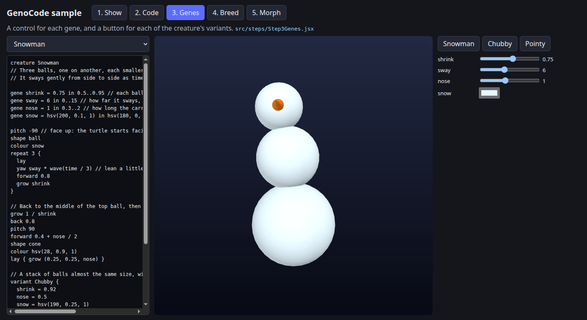
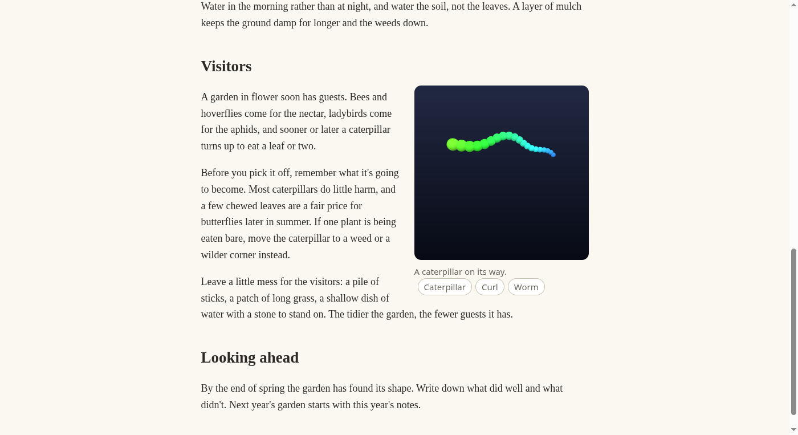

<p align="center"></p>

# GenoCode sample

A small React site that shows what the [GenoCode](https://github.com/genocode-org/GenoCode)
libraries can do in a web page:

- [`@genocode/core`](https://www.npmjs.com/package/@genocode/core) reads a creature's code, runs
  it, and mutates, breeds and morphs its genes.
- [`@genocode/render`](https://www.npmjs.com/package/@genocode/render) draws the creature in 3D on
  a canvas.
- [`@genocode/controls`](https://www.npmjs.com/package/@genocode/controls) makes a slider, colour
  picker, checkbox or menu for each gene.



## Run it

You need [Node.js](https://nodejs.org) 22 or newer.

```
git clone https://github.com/genocode-org/GenoCode-sample.git
cd GenoCode-sample
npm install
npm run dev
```

Then open the address it prints (usually http://localhost:5173).

## The steps

The site has five steps. Each one is a sample by itself, in one file in `src/steps`, and each
adds one idea to the step before. The comment at the top of each file says what's new.

1. **Show** (`Step1Show.jsx`): a creature on a canvas in three calls: `check`, `build` and
   `setCreature`.
2. **Code** (`Step2Code.jsx`): change the code and the creature changes; mistakes are listed.
3. **Genes** (`Step3Genes.jsx`): a control for each gene (`@genocode/controls`) and a button for
   each variant.
4. **Breed** (`Step4Breed.jsx`): a grid of mutants and children, with `mutate`, `breed` and
   `Thumbnails`.
5. **Morph** (`Step5Morph.jsx`): a smooth loop through the creature's variants, with `morph`.

The other files:

- `src/CreatureCanvas.jsx`: step 1's code as a React component, which steps 2 to 5 use.
- `src/GeneControl.jsx`: a gene's control from `@genocode/controls` as a React component.
- `src/creatures`: three short creatures written for this sample (a snowman, a flower and a
  caterpillar), each about 40 lines of GenoCode. `src/creatures.js` lists them. Bigger creatures
  come with `@genocode/core`; `src/creatures.js` says how to try one.
- `src/App.jsx`: the page with the step buttons.
- `src/styles.css`: the styling of the five steps.
- `article.html`, `src/article.js` and `src/article.css`: the article page (see below).

## Use it in your own site

The libraries are on npm, and none of them need React:

```
npm install @genocode/core @genocode/render @genocode/controls
```

Start from step 1: it's the smallest page that shows a creature. Each later step adds one idea,
so take only the ideas you need.

### Creatures in a page of text

`article.html` is an ordinary web page, a short article about a spring garden, with two creatures
in it. They sit in the text the way pictures do: the flower is as wide as the text, and the
caterpillar stands beside the paragraphs, which flow round it. Each one has buttons for its
variants under it. Open it at http://localhost:5173/article.html, or with the link at the top of
the five steps.



The page uses no React. `src/article.js` puts a creature in every
`<canvas data-creature="Name">`, so to add one to a page you add a canvas and size it with CSS.
It also does a few things a page full of text needs:

- The camera is locked, so scrolling over a creature scrolls the page instead of zooming.
- The camera frames everything the creature does over its first few seconds, so one that moves a
  lot stays in its picture.
- A creature moves only while it's on the screen, and stands still for people who have asked
  their system for less motion.

## Where to go next

- [Getting started](https://genocode.piorek.co.za/docs/), to write your first creature.
- The [GenoCode app](https://genocode.piorek.co.za/app/), to code, breed and dance creatures in
  the browser.
- The language creatures are written in:
  [LANGUAGE.md](https://github.com/genocode-org/GenoCode/blob/main/docs/LANGUAGE.md).
- [`@genocode/controls`](https://www.npmjs.com/package/@genocode/controls), used in step 3, also
  has sliders that stand in for time and music (`InputControls`).

MIT licensed.
